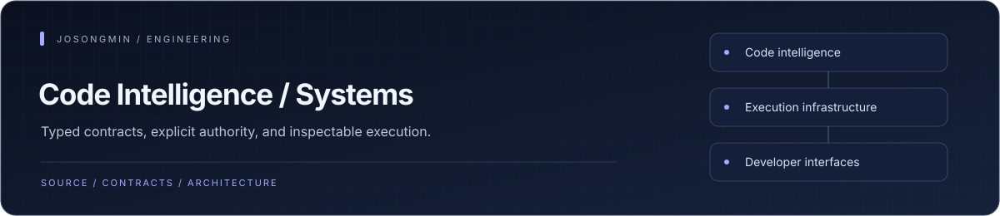

# Songmin

I build **code intelligence, coding agents, and the infrastructure that governs their execution**: search, language frontends, resource budgets, and developer interfaces.

My work combines **Rust systems** with **TypeScript and Python tooling**. I focus on explicit contracts, observable failure, and verification tied to the source that produced it.

[Selected work](#selected-work) · [Project directory](PROJECTS.md) · [All repositories](https://github.com/josongmin?tab=repositories)

## Selected work

| Project | Engineering focus | Explore |
| :--- | :--- | :--- |
| **[Quanta CodeAgent v3](https://github.com/josongmin/quanta-codeagent-v3)** | Coding agent runtime: ordered streaming tools, versioned sessions, context compaction, checkpoints, and an embeddable SDK. | [Runtime architecture](https://github.com/josongmin/quanta-codeagent-v3/blob/main/docs/architecture/runtime-overview.md) |
| **[Quanta Index](https://github.com/josongmin/quanta-index)** | Search infrastructure: typed ingestion, immutable generations, publication, explicit activation, and a producer SDK. | [Producer SDK](https://github.com/josongmin/quanta-index/blob/main/crates/quanta-index-sdk/README.md) |
| **[Quanta Taskmesh](https://github.com/josongmin/quanta-taskmesh)** | Execution governance: bounded admission, fairness, cancellation, and worker-capacity custody. | [Execution contract](https://github.com/josongmin/quanta-taskmesh/blob/main/docs/taskmesh-external-interface.md) |
| **[Quanta Memory Platform](https://github.com/josongmin/quanta-memory-platform)** | Memory governance: explicit budgets, ownership accounting, custody transfer, and reclaim. | [Use cases](https://github.com/josongmin/quanta-memory-platform/blob/main/docs/product/use-cases.md) |
| **[Quanta GQLang](https://github.com/josongmin/quanta-gqlang-v2)** | Query-language frontend: syntax, binding, types, normalized IR, and checked host-neutral execution documents. | [Frontend contract](https://github.com/josongmin/quanta-gqlang-v2/blob/main/docs/contracts/frontend-execution-v3.md) |
| **[Quanta AI IDE v2](https://github.com/josongmin/quanta-ai-ide-v2)** | Developer workbench: registered surfaces, code visualization, agent sessions, and scoped React/Tauri infrastructure. | [Workbench guide](https://github.com/josongmin/quanta-ai-ide-v2/blob/main/docs/workbench-handoff.md) |

## Engineering priorities

- **Explicit authority.** Keep contracts, semantic decisions, execution, and storage under clear owners.
- **Bounded resources.** Make admission, cancellation, memory retention, and worker lifetime inspectable.
- **Source-bound evidence.** Distinguish implementation, executed verification, consumer integration, and release status.

## Beyond the core

- **Developer interfaces:** [Terminal](https://github.com/josongmin/quanta-terminal) · [Modular IDE](https://github.com/josongmin/quanta-ide) · [Code City prototype](https://github.com/josongmin/quanta-code-city)
- **Search and data:** [Wine search](https://github.com/josongmin/wine-search-engine) · [Recommendation pipelines](https://github.com/josongmin/recommandation-ml-w) · [Crawler workspace](https://github.com/josongmin/crawler-engine-web-w)
- **Earlier foundations:** [Semantica Codegraph](https://github.com/josongmin/semantica-codegraph) · [Semantica Copilot](https://github.com/josongmin/semantica-copilot) · [Task Engine](https://github.com/josongmin/semantica-task-engine)

[Browse the complete public project directory →](PROJECTS.md)
